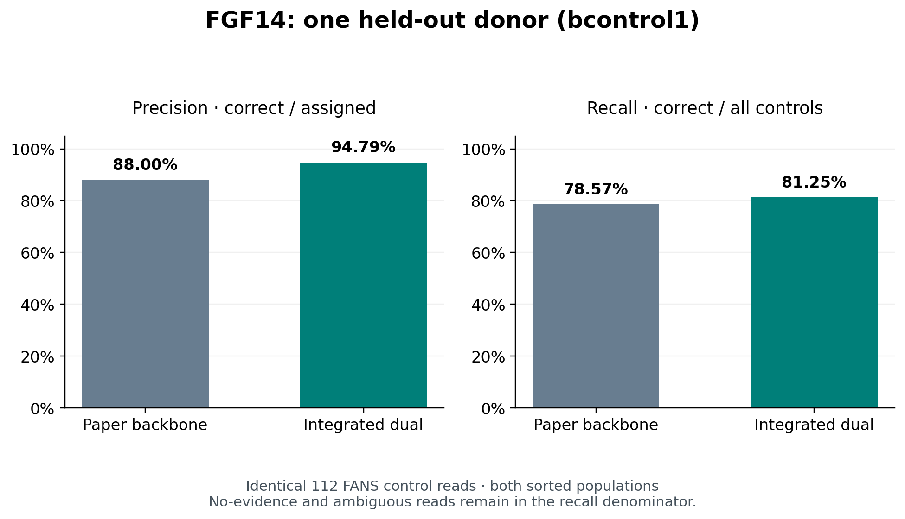
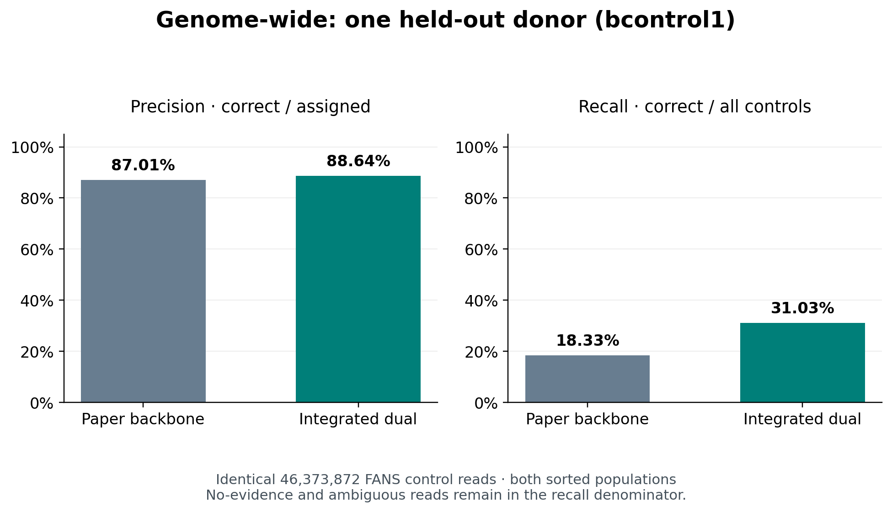
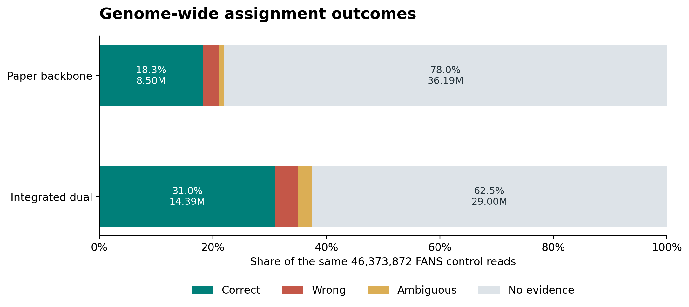

# A first held-out test of the 5hmC-aware SniffCell atlas

This quick validation holds out one control donor, bcontrol1. Both its neuronal and oligodendrocyte FANS samples are excluded from atlas discovery; bmsa, bparkinsons, and bcontrol2 provide the training data. This is a single-donor proof of concept, not a completed four-donor validation.

The sole baseline is the paper’s 152,961-region modifiedC catalog, `brain_cereb.maxgap3000_dt04.ctdmr.tsv`. The integrated atlas keeps this backbone and adds eligible training-only ONT 5mC and 5hmC markers. Earlier comparisons using a different backbone are superseded.

Sorted FANS sample identity provides the reference cell-type label. TP is a read assigned to its source population; FP is a read from the other population assigned to that type. FN includes wrong assignments, ambiguous reads, and reads with no evidence. Precision is TP/(TP+FP); recall is TP/(TP+FN). These labels inherit the purity limitations of population sorting. Actual bulk reads do not have per-read truth here; matched-FANS methylation concordance is a separate assessment, deferred in this quick run.

## FGF14

Both atlases receive the same pooled FANS reads spanning the full interval chr13:102161539–102161869. Selection uses primary alignments only, without methylation or assignment filters. All catalog markers overlapping those read spans are supplied, with no atlas-dependent nearest-marker window.

| Atlas | Control reads | Correct / assigned | Micro-precision | Micro-recall | No evidence | Ambiguous |
|---|---:|---:|---:|---:|---:|---:|
| Integrated dual | 112 | 91 / 96 | 94.79% | 81.25% | 1 | 15 |
| Paper backbone | 112 | 88 / 100 | 88.00% | 78.57% | 1 | 11 |

## Genome-wide

Both atlases use the same FANS BAMs and frozen unique primary-read identities. Reads without assignment evidence remain in the recall denominator.

| Atlas | Control reads | Correct / assigned | Micro-precision | Micro-recall | No evidence | Ambiguous |
|---|---:|---:|---:|---:|---:|---:|
| Integrated dual | 46373872 | 14391267 / 16236450 | 88.64% | 31.03% | 29000314 | 1137108 |
| Paper backbone | 46373872 | 8502346 / 9772112 | 87.01% | 18.33% | 36188547 | 413213 |

## Backward compatibility and remaining scope

The paper backbone passed exact comparison of all historical columns in 4 FGF14 result tables against pre-5hmC code. Added provenance columns are excluded from that comparison. This regional check does not establish genome-wide parity.

Other donor folds, single-channel ablations, and bulk/FANS checks are deferred to keep this first test small. One held-out donor cannot establish performance across donors. No tagged package release has been made.

## Benchmark plots

## How 5hmC incorporation was reimplemented

### Separate assays from discovery through read assignment

The change extends the existing ctDMR discovery and deconvolution workflows. The catalog carries a `modification` field on each marker: `modifiedC`, `5mC`, or `5hmC`. Reference means, effect direction, and read scoring remain associated with that marker’s assay. In particular, 5mC and 5hmC probabilities are not added together when evaluating a channel-specific marker. Opposite directions in the two assays are retained as separate evidence.

The MDB discovery path reads the requested assay, haplotype, and strand tracks in batches. `--assay dual` runs discovery separately for 5mC and 5hmC and concatenates the annotated outputs. It does not discover markers from a pooled m+h track. The historical NPY discovery path remains available. The main implementation points are `src/sniffcell/find/find.py` and `src/sniffcell/find/ctdmr.py`.

### Build the new reference without the held-out donor

For this validation, both bcontrol1 samples are excluded from the sample mapping used for reference means and paired stability filtering. The three training pairs are bmsa, bparkinsons, and bcontrol2, each with Neuron and Oligodendrocyte data. Holding out the donor is implemented through selected sample columns; the underlying MDB can still contain all samples. The fixed coordinate index is shared, but the held-out values are not used for training means or marker selection.

Before segmentation, the paired filter requires finite Neuron-minus-Oligodendrocyte effects in all three training donors, a common direction, an absolute median effect of at least 0.40, support of at least 0.30 in all three donors, and a minimum absolute effect of 0.15. With all three required to exceed 0.30, the 0.15 condition is redundant in this configuration. The ctDMR caller also uses a group-mean effect threshold of 0.40, a minimum of three CpGs, `min_rows=1`, and a maximum merge gap of 3,000 bp. These settings were fixed for the comparison rather than tuned against bcontrol1.

### Preserve the paper backbone when integrating markers

The integration starts with the exact 152,961-region `brain_cereb.maxgap3000_dt04.ctdmr.tsv` catalog used in the paper’s FANS benchmark. Its original intervals and reference values are retained. Annotation adds assay and evidence provenance; the backbone is not replaced or resegmented.

An ONT marker that overlaps a backbone interval by at least one base, using half-open BED coordinates, is retained in the overlap/evidence outputs but is not added as a duplicate scoring row. ONT markers with no backbone overlap are added with their own assay labels. Novel 5mC and 5hmC markers may overlap each other and remain separate scoring records. This avoids duplicate ONT rows over the legacy backbone, but does not claim statistical independence between all channel-specific records.

For the bcontrol1-held-out fold:

| Component | Marker rows |
|---|---:|
| Original modifiedC backbone | 152,961 |
| Added 5mC markers outside the backbone | 204,986 |
| Added 5hmC markers outside the backbone | 157,935 |
| Integrated scoring catalog | 515,882 |

The integrated catalog covers 394,976 merged genomic components. Marker-row counts therefore differ from counts of distinct genomic regions. Integration is performed by `build_dual_ctdmr_catalog.py`; the aggregate catalog summary records the input counts and overlap policy.

### Match each catalog marker to the appropriate BAM calls

The default `--bam-modification auto` follows the catalog row’s `modification` label. A legacy catalog with no such column defaults to `modifiedC`. This is dispatch by catalog metadata, not automatic recognition of the basecaller model’s biological meaning.

| Catalog row | BAM modification codes requested | Behavior with an m-only BAM |
|---|---|---|
| `modifiedC` | `m` and `h`, when available | Uses available m probabilities |
| `5mC` | `m` only | Uses m probabilities |
| `5hmC` | `h` only | No matching evidence; marker skipped |

The extractor maps modification calls to reference CpGs, including reverse-strand coordinate handling, and converts stored probabilities using `score / 255`. A read with no usable calls for the requested assay is removed from that marker’s matrix. A marker with fewer than two usable reads is skipped. Missing h calls are not manufactured from m calls and are not interpreted as observed zero 5hmC.

An m-only BAM does not, by its tag alone, establish whether the underlying model separately measured 5mC or supplied an older modifiedC-like signal. The current implementation does not resolve that distinction. An older combined signal should not automatically be described as a validated pure-5mC input for the new atlas.

For legacy modifiedC extraction, the historical probability combination is retained: `1 - (1 - p_m) * (1 - p_h)`, using the available channel if only one is present. This is an implementation convention, not a claim that it is identical to summing modified counts in a pileup. Channel-specific rows use only their selected probabilities. The extraction and dispatch code is in `src/sniffcell/anno/methyl_matrix.py` and `src/sniffcell/anno/anno.py`.

### Score reads using assay-matched reference means

Within a marker, missing CpG entries are imputed using the observed column mean among the supplied reads. Channel-specific scoring then averages across observed columns. This dependence on the supplied read cohort is why the regional benchmark reruns each atlas on the identical frozen BAM, rather than selecting matching read IDs from previously scored, differently subsetted inputs.

The benchmark explicitly uses `--read_assignment_mode closest_reference_mean` and `--per_read_min_agreement 0.66`. Each marker compares a read’s mean with that marker’s best-group and remaining-group reference means. The existing per-read consensus machinery combines the resulting cell-type codes. These are assay-specific marker assignments feeding the existing consensus, not an average of 5mC and 5hmC methylation values. Mixed or unresolved assignments remain ambiguous in evaluation.

An explicit `--bam-modification` value overrides dispatch for every row. Forcing `modifiedC` on a dual catalog therefore changes which signal is compared with its channel-specific reference means; it is not an automatic fallback for missing h calls. Forced-channel runs are not part of the reduced, two-atlas genome-wide comparison.

### Keep historical modifiedC behavior intact

Three compatibility details were addressed during implementation:

- Legacy modifiedC scoring retains the previous plain row mean after column-mean imputation, including its behavior when a whole CpG column remains missing. The new channel-specific paths use a NaN-aware mean. Applying the latter globally would change historical outputs.
- Regional nearest-marker selection retains the historical first-tie behavior for a single-channel catalog. Ties are retained together when the chromosome’s catalog contains multiple channels, so a channel record is not arbitrarily dropped. The fixed FGF14 benchmark itself supplies all overlapping markers and does not use nearest-N selection.
- An omitted or empty low-level `wanted_keys` argument retains its historical default behavior. Explicit assay selection provides the channel-specific keys.

The relevant code is in `src/sniffcell/anno/anno.py`, `src/sniffcell/anno/methyl_matrix.py`, and `src/sniffcell/deconv/regions.py`. Regression coverage includes missing-CpG legacy behavior, empty key selection, regional distance ties, and invariance of training calculations to changes in excluded-donor values.

For the paper backbone on the frozen bcontrol1 FGF14 control, all historical fields matched pre-5hmC code exactly in four tables: read summary, read classification, block classification, and overall summary. New modification provenance fields are excluded from that comparison. This is verified regional compatibility, not a completed genome-wide comparison against old code. The genome-wide baseline reported here uses the updated implementation with the original paper catalog.

### Distinguish this benchmark from the release atlas

The reported genome-wide precision and recall are new measurements on sorted FANS reads, with source population as the reference label. They do not reproduce the paper’s bulk-read methylation-disagreement metric. Every atlas is assessed on the same frozen primary-read universe; reads with no evidence or ambiguous outcomes stay in the recall denominator. This validation compares the integrated addition of both ONT assays with the original backbone. Without the deferred single-channel ablations, it does not isolate how much of the improvement is attributable to 5hmC alone.

The held-out atlas uses three donors. The distributable build has now been rebuilt with all four donors, including bcontrol1, and checked as a separate artifact. It contains 489,972 scoring rows: the 152,961-row paper backbone, 194,662 added 5mC rows, and 142,349 added 5hmC rows. It covers 378,216 merged genomic components. All original backbone text fields were preserved exactly. This four-donor build uses at least three strongly supporting donors out of four; the held-out build requires all three training donors. The [catalog and manifest](https://github.com/Fu-Yilei/SniffCell/tree/5hmC_compatitible_atlas/atlases/5hmc) are distributed separately from the Python wheel. The held-out results remain validation evidence; they should not be represented as an independent evaluation of the all-four-donor release atlas. The current atlas retains the legacy backbone unchanged throughout this holdout design.

### Merge and packaging validation

The 5hmC software branch incorporates the current main-branch precomputed tissue atlases, CLI update, and v0.9.7 packaging changes. An older main-branch revert also removed MDB discovery during the merge; the separate-assay discovery and donor-filtering implementation was restored. The merged source passes 273 tests and 3 subtests. Wheel and source distributions build and pass metadata checks. No PyPI prerelease tag has been published as part of this update. The workflow now supports prerelease tags without moving Docker `latest`.
