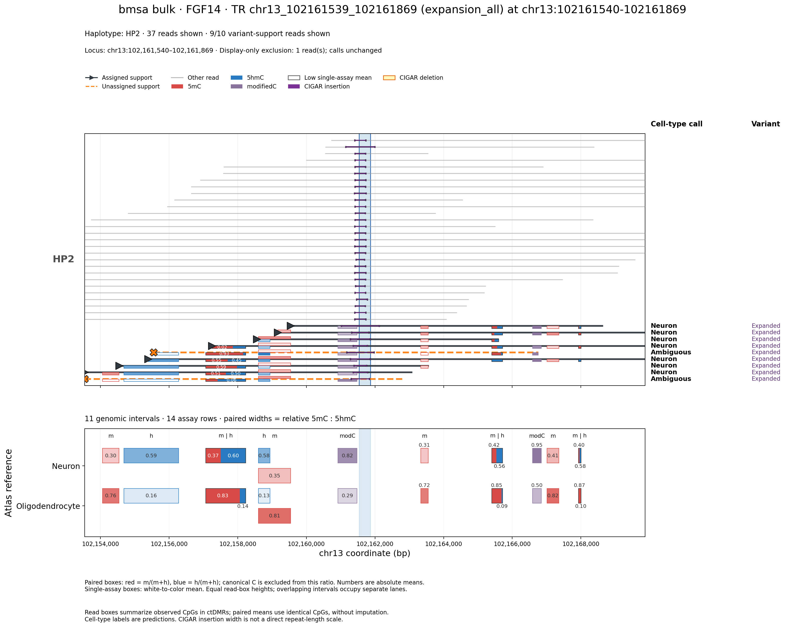

# Seeing 5mC and 5hmC together in SniffCell

*10 September 2026 · development update after v0.9.8a1*

The new atlas adds separate 5mC and 5hmC evidence while keeping the original
paper modifiedC backbone. This update makes that evidence visible in the
familiar SniffCell layout: read tracks above, cell-type reference ctDMRs below,
and variant support and predicted cell types beside the reads.

The code is on the [5hmC branch](https://github.com/Fu-Yilei/SniffCell/tree/5hmC_compatitible_atlas).
This illustration was generated from implementation [a5c05e6](https://github.com/Fu-Yilei/SniffCell/commit/a5c05e60bbcb5341c02a94f67670506258c55da2).
It is newer than the published v0.9.8a1 wheel. The earlier
[FANS benchmark update](../06_06_heldout_validation/BLOG_UPDATE.md) remains the
accuracy evaluation; the bulk-read example here is a visualization illustration.

## The bmsa FGF14 example



**Figure selection.** This is bmsa bulk, using the full four-donor atlas, with
no donor excluded. The figure shows 37 repeat-spanning HP2 reads and 9 of the
original 10 expansion-support reads. One borderline support read with an
Oligodendrocyte prediction was deliberately omitted from this illustration;
the omission is also printed on the figure. The original calls retain that
read. The displayed support predictions are 7 Neuron and 2 ambiguous; the
unfiltered support set is 7 Neuron, 1 Oligodendrocyte and 2 ambiguous.
This selected illustration must not be interpreted as assignment accuracy or
as evidence that all expanded reads are neuronal.

The omitted read only just passed the original support threshold. The original
post-processing used padded Medaka sequences: 1,466 bp for this read, versus a
1,412 bp baseline maximum and a required 50 bp margin, leaving 4 bp above the
strict cutoff. A separate TRGT check gives a flank-trimmed estimate of 995 bp
versus a 915 bp baseline maximum. These are different length measurements and
must not be mixed. Neither establishes the bulk read's true cell type, and the
Oligodendrocyte prediction was not changed to make the example look cleaner.

The fixed display window contains **14 assay rows in 11 distinct genomic
intervals**, including three exact m/h pairs. Cell-type calls use markers
across the full retained alignments, including markers outside this figure.
All 98 primary reads spanning the repeat were retained for the local scoring
run; the HP2 filter and one-read exclusion affect the illustration only.

[Download the PDF](results/FGF14_bmsa_5hmc_viz.pdf).

## Reading the boxes

Each read box summarizes observed CpGs within an overlapping ctDMR. There is
no per-CpG mosaic to mentally connect to a separate reference panel. Paired
read summaries use the **same observed CpGs** for m and h, without imputation.

When the atlas has exact matching boundaries for both assays, the interval is
shown as a joined box. The red width is `m/(m+h)` and the blue width is
`h/(m+h)`. Numeric labels are the absolute assay means, not those normalized
shares. For example, the upstream Neuron reference has approximately 0.37 m
and 0.60 h, producing about 38% red and 62% blue.

The interior split is a ratio encoding, not a genomic boundary. It does not
represent canonical C: the separately summarized atlas means are not assumed
to be a measured three-state composition. A zero total has no defined m:h ratio
and is neutral; missing paired observations are not treated as zeros.

Single-assay intervals retain their white-to-color mean scale. Purple marks
the historical modifiedC channel; white means low selected-assay signal.
Partial overlaps retain their own boundaries and separate lanes. All read
ctDMR boxes have equal height, so height does not imply confidence or evidence
strength. Purple CIGAR insertion marks remain distinct from methylation boxes
and do not provide a direct repeat-length scale.

The native support-haplotype filter is retained. When phased supporting reads
identify one haplotype, the background reads are restricted to that haplotype,
while supporting reads are retained. Here that haplotype is HP2.

## What changed in the implementation

The ctDMR loader now preserves `modification`; marker keys and exported evidence
retain it too. Consequently a 5mC row and a 5hmC row at identical coordinates
remain separate measurements rather than overwriting or collapsing each other.
The assay-aware extractor dispatches to the corresponding modification channel
and intersects observed CpG positions before calculating a paired read summary.

The renderer reuses SniffCell's native read ordering, support arrows, haplotype
handling and CIGAR geometry. It replaces the methylation overlays and reference
boxes with the assay-aware versions. A shared height and interval-lane layout
keep exact pairs and partial overlaps legible. No scoring thresholds or read
assignments are changed by drawing the boxes.

The new view uses saved deconvolution consensus labels when available. Otherwise
it calls the same intersection/conflict-threshold consensus implementation used
by the classifier, rather than treating a simple plurality as a confident read
assignment. This preserves ambiguous labels in the display. Original modifiedC
visualizations continue through their original label/rendering path.

`--linked_ctdmr_mode auto` selects bottom genomic tracks for separate-assay
atlases and the original distal layout for legacy atlases. The genomic mode
includes the nearest six distinct intervals on each side by default; both
assays are kept when an interval is paired. A fixed window can still be selected
with `strict`. `report --with_figures` invokes this same renderer, preserving
the existing report filtering and review interface.

An explicit `--exclude_read_names` option supports selected illustrations.
It changes only which reads are drawn, prints the omitted-read count on the
figure and records `display_excluded` in the assignment export. It does not
remove the read from the caller's support set or the scoring results. This
option is off by default; the unfiltered report check retained all 10 support
reads.

The joined box also does **not** change voting. Separate m/h assignment rows
still contribute separately to read consensus, even at identical coordinates.
Compatible calls are intersected; genuine conflicts use per-row plurality
with the configured agreement threshold. These channels are not independent
loci and are not downweighted. A resolved supporting read subsequently supplies
one variant-level vote.

## Compatibility and checks

The original atlas and scoring code were not changed. Legacy atlases without a
modification column, or with only `modifiedC`, keep the original extraction and
rendering paths. On a real bmsa legacy-atlas example, the extracted table was
exactly equal and the PNG byte-identical to the pre-change branch renderer.

The full test suite passed **280 tests plus 3 subtests**. Focused checks cover
assay-preserving keys, matched observed CpGs, missing channels, proportional
box widths, uniform heights, partial overlaps, saved consensus precedence and
legacy dispatch. The actual bmsa PNG/PDF were generated through the updated
`sniffcell viz` CLI. The report rendering worker was also exercised on the
same sample with no read exclusion.

## Trying this branch

```bash
pip install --upgrade "git+https://github.com/Fu-Yilei/SniffCell.git@5hmC_compatitible_atlas"

sniffcell viz --anno_output sample_anno --sv_id VARIANT_ID \
  --sample_label "Sample name" --export_tables -o sample.viz.png

sniffcell report --anno_output sample_anno --with_figures -o sample_report
```

The [command documentation](https://github.com/Fu-Yilei/SniffCell/blob/5hmC_compatitible_atlas/docs/5hmc-visualization.md)
and [reproduction script](scripts/render_example.py) describe the inputs and
fixed-window options. Raw reads, sequencing read identifiers, private paths
and variant-call tables are not distributed in this blog folder; rerunning
the example requires authorized access to those inputs.
